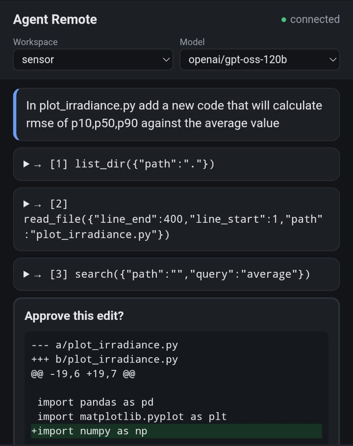
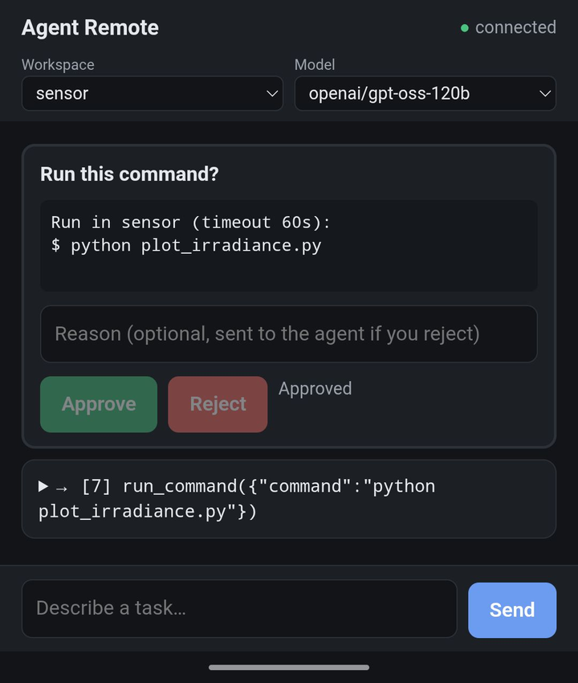
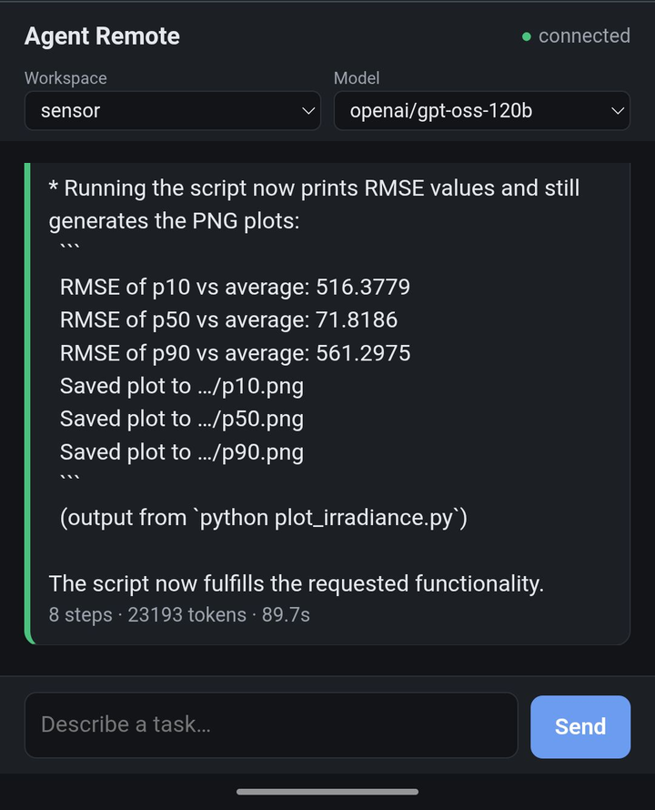
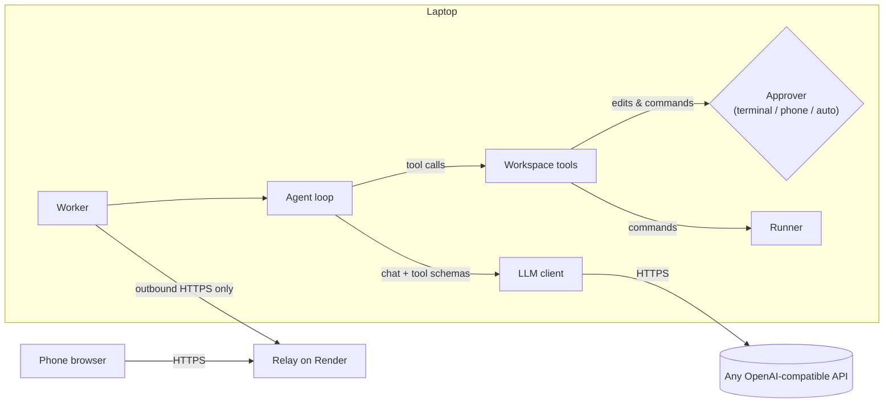
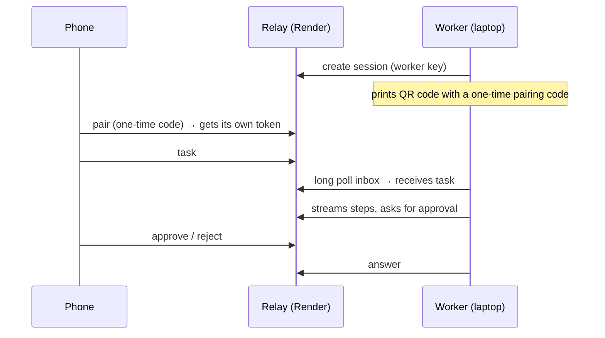
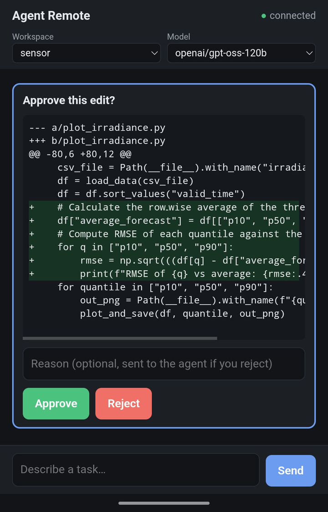
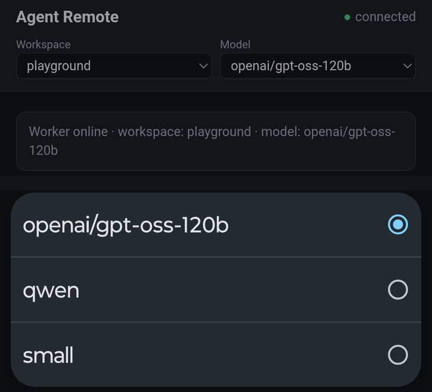

# Code Agent

An AI coding agent built from scratch in Python (no agent frameworks). It explores a codebase, answers questions about it, edits and creates files, and runs code and tests to check its own work. **Every change and every command needs your approval**, from the terminal or **from your phone**.

<p align="center">
  
  
  
</p>
<p align="center"><em>From the phone: ask for a change → approve the edit and the command → the agent runs the script and reports the result.</em></p>

## Features

- **Tool-calling agent loop.** The model decides which tool to call next, sees the result, and continues until it can answer. A step limit and a forced final answer stop it from looping forever.
- **Six tools:**

  | Tool | What it does |
  |---|---|
  | `list_dir` | List files and folders (skips hidden folders and `__pycache__`) |
  | `read_file` | Read a file in numbered chunks (`start_line` / `end_line`); notebooks are converted to readable cells |
  | `search` | Case-insensitive text search across the project, returning `file:line: text` |
  | `edit_file` | Replace one exact, unique piece of text; shows a diff for approval |
  | `create_file` | Create a new file (never overwrites); shows the full content for approval |
  | `run_command` | Run `python` or `pytest` in the project and return the exit code and output, after approval |

- **Any model.** One OpenAI-compatible client works with Groq, OpenAI, OpenRouter, a local Ollama server, or any other compatible server (`base_url`).
- **Human approval for every write and command**, in the terminal, on the phone, or auto-approved in evals on throwaway copies.
- **Remote control from a phone.** Send tasks, watch every step, and approve edits and commands from a web page, with no open ports on your laptop.
- **Evaluation harness.** Runs the agent on tasks in isolated repo copies and grades the result with hidden pytest tests.
- **Structured run logs.** Every run is saved as JSON: model calls, tool calls, errors, tokens and timings.

## Architecture



```
code-agent/
├── codeagent/            # the agent (runs on your laptop)
│   ├── agent.py          # Agent(llm, workspace).run(question): the loop, system prompt, retries, step limit
│   ├── llm.py            # LLM(provider, model, base_url): one client for every provider
│   ├── tools.py          # Workspace(root, approve, runner): the tools, path guard, tool schemas
│   ├── runner.py         # LocalRunner: how commands execute (pluggable, ready for a Docker runner)
│   ├── logger.py         # RunLogger: JSON run logs in runs/
│   └── worker.py         # connects the agent to the relay; phone approvals, workspace/model switching
├── relay/                # the server (deployed to Render); passes messages, never runs code
│   ├── relay.py
│   ├── static/index.html # the phone page
│   └── requirements.txt  # fastapi + uvicorn only
├── evals/                # evaluation harness, tasks and practice repos
│   ├── eval.py
│   ├── tasks.json
│   └── repos/
├── examples/playground/  # small practice repo to try the agent on
├── docs/                 # screenshots
└── requirements.txt      # what the agent needs
```

Everything the agent needs (which folder, which model, how to approve, how to run commands) is **passed in**, not stored in globals. That makes it possible to run several agents side by side, swap models per run, and test each part on its own.

## Quick start

**Requirements:** Python 3.10+, a Groq API key (free tier works) or any other OpenAI-compatible provider.

```bash
git clone https://github.com/<you>/<repo>.git
cd <repo>
python -m venv .venv
source .venv/bin/activate          # Windows: .venv\Scripts\Activate.ps1
pip install -r requirements.txt
```

Create a `.env` file in the project folder (it is git-ignored):

```dotenv
GROQ_API_KEY=your-groq-key
AGENT_WORKSPACE=/path/to/the/repo/you/want/to/work/on
```

Run everything from the project's root folder. Ask a question or give a task:

```bash
python -m codeagent.agent "What does this project do?"
python -m codeagent.agent "test_total_value fails. Find the bug, fix it, and run the tests to confirm."
```

Each edit and command is shown first and waits for `y`. Anything else rejects it, and whatever you type is passed to the agent as the reason.

**Windows:** run Python in UTF-8 mode so files with non-English text are read and written correctly: `python -X utf8 -m codeagent.agent "..."` (or set `PYTHONUTF8=1` once). Use forward slashes in paths in `.env`, e.g. `C:/Users/me/repos/project`.

### Choosing a model

```bash
AGENT_MODEL=openai/gpt-oss-20b python -m codeagent.agent "..."                       # another Groq model
AGENT_PROVIDER=openrouter AGENT_MODEL=<model id> python -m codeagent.agent "..."     # needs OPENROUTER_API_KEY
AGENT_PROVIDER=ollama AGENT_MODEL=qwen2.5-coder:7b python -m codeagent.agent "..."   # local model, no key
```

On Windows PowerShell, set variables first: `$env:AGENT_MODEL="openai/gpt-oss-20b"; python -m codeagent.agent "..."`.

## Control it from your phone



The laptop only makes **outgoing** HTTPS requests, so it works behind home routers and mobile networks (NAT, CGNAT) without opening ports or installing a VPN.

**1. Deploy the relay** (once), e.g. on Render as a free web service:
- Root Directory: `relay` (only that folder is deployed, so changes to the agent don't restart the relay)
- Build command: `pip install -r requirements.txt`
- Start command: `uvicorn relay:app --host 0.0.0.0 --port $PORT --proxy-headers --forwarded-allow-ips="*"`
- Environment variable: `RELAY_WORKER_KEY` = a long random secret:
  `python -c "import secrets; print(secrets.token_urlsafe(32))"`
- Health check path: `/health`

**2. Configure the laptop** (`.env`):

```dotenv
RELAY_URL=https://<your-relay>.onrender.com
RELAY_WORKER_KEY=the-same-secret-as-on-the-relay
AGENT_WORKSPACES=app=~/code/app,tools=~/code/tools
AGENT_MODELS=small=groq:openai/gpt-oss-20b,local=ollama:qwen2.5-coder:7b
```

**3. Start the worker and scan the QR code:**

```bash
python -m codeagent.worker
```

The page shows each step, asks for approval of edits and commands, and has dropdowns to switch **workspace** and **model** between tasks. Press Enter in the worker's terminal for a new pairing link (e.g. for another device).

<p align="center">
  
  
</p>

## Safety

| Risk | Protection |
|---|---|
| Agent reads or writes outside the project | Every path is resolved and must stay inside the workspace (`../` and absolute paths are refused) |
| Unwanted changes | Every edit, new file and command needs approval; a rejection reason is passed back to the model |
| Overwriting files by accident | `create_file` refuses existing files; `edit_file` requires an exact, unique match |
| Writing into `.git` (e.g. hooks that run on commit) | Creating files in hidden folders is refused |
| Dangerous commands | Only `python` and `pytest` are allowed; no shell, so `&&`, pipes and redirection cannot chain commands |
| Runaway scripts | Timeout (default 60 s, max 300 s), no keyboard input, output size limits |
| Model-written code stealing API keys | Environment variables containing `KEY`, `TOKEN`, `SECRET`, `PASSWORD` or `CREDENTIAL` are removed before running commands |
| Someone else controlling your laptop through the relay | Only holders of `RELAY_WORKER_KEY` can create sessions; phones pair with a one-time, expiring code and get their own token; failed attempts are rate-limited per IP |
| Phone pointing the agent at arbitrary folders or models | The phone only sends a **name** from allowlists defined on the laptop (`AGENT_WORKSPACES`, `AGENT_MODELS`) |
| Code from the repo executing in the phone page | All event data is rendered with `textContent`, never `innerHTML` |

**Limitation:** an approved command runs with your user's permissions. Approval and the rules above make it much safer, but it is **not a sandbox**. Read code before approving a run. Container isolation is on the roadmap.

## Evaluation

```bash
python -m evals.eval                                        # all tasks
python -m evals.eval --task inv-fix-total-value             # one task
python -m evals.eval --provider ollama --model qwen2.5-coder:7b   # compare models
```

For each task the harness:
1. copies the repo to a temporary folder, so tasks never affect each other;
2. records which tests fail **before** the agent runs (the target tests must be among them);
3. **hides the test files** for fix tasks, so the agent must fix the code from the description, not from the tests;
4. runs the agent with auto-approval on the copy;
5. restores the tests and grades: the target tests must pass, no previously passing test may break, and question tasks must not change any file.

Results (pass/fail, steps, tokens, errors) are printed and saved in `eval_results/`.

> Evals auto-approve commands, which run on your machine (on a temporary copy of the repo). Only run them with models you trust until container isolation is added.

## Configuration

| Variable | Used by | Meaning |
|---|---|---|
| `GROQ_API_KEY` / `OPENAI_API_KEY` / `OPENROUTER_API_KEY` | agent | Key for the chosen provider |
| `AGENT_PROVIDER` | agent | `groq` (default), `openai`, `openrouter`, `ollama` |
| `AGENT_MODEL` | agent | Model name (default: the provider's default) |
| `AGENT_BASE_URL` | agent | Any other OpenAI-compatible server |
| `AGENT_WORKSPACE` | agent, worker | Project folder to work on (default: `examples/playground/`) |
| `AGENT_WORKSPACES` | worker | Folders the phone may switch to: `name=path,name=path` |
| `AGENT_MODELS` | worker | Models the phone may switch to: `label=provider:model,...` |
| `RELAY_URL` | worker | Address of your relay |
| `RELAY_WORKER_KEY` | worker, relay | Shared secret that lets the worker create sessions |
| `SESSION_LIFETIME`, `PAIRING_LIFETIME` | relay | Seconds a session / pairing code stays valid (12 h / 10 min) |

## Design decisions

- **No framework.** The loop is ~100 lines and every step is visible: what is sent, what comes back, how errors are handled. That made provider quirks (malformed tool calls, rate limits) easy to debug and fix.
- **Errors go back to the model, not up the stack.** A wrong path, a missing argument or a failed edit becomes a tool result explaining what to do next ("Use list_dir…", "Allowed: …, Required: …"). Most mistakes are corrected on the next step. Only problems the model cannot fix (bad API key, unknown model) crash the run.
- **Exact-text edits instead of line numbers.** Line numbers shift after every edit; a unique snippet of text does not. The edit must match exactly once, so the agent can never change the wrong place silently.
- **Approval is a pluggable function.** `edit_file`, `create_file` and `run_command` call `approve(text)`; the terminal, the phone and the eval harness each provide their own.
- **Dependency injection over globals.** The first version swapped a global `WORKSPACE` and `ask_approval` from other files. Passing them in (`Workspace`, `LLM`, `Agent`) made the code testable and allows several agents to run at once without interfering.
- **A relay instead of exposing the laptop.** The laptop only makes outgoing requests; no port forwarding, no VPN, works behind CGNAT. The relay only stores and forwards messages and never executes anything.
- **One-time pairing codes, never tokens in links.** Links end up in browser history and screenshots; a code that works once and expires in 10 minutes is harmless afterwards. The code is also removed from the address bar immediately.
- **Hidden tests in evals.** If the agent can read the tests, it can fit the code to them; hiding them measures whether it understands the task.

## Findings from testing

Testing on real repositories with several models surfaced issues that shaped the design:

- **Guessing instead of exploring.** Asked about a file by a loose description, one model invented a path (`new/data half/Data half.py`) and spent three steps narrowing the guess before listing the folder. Error messages that say what to do next made it recover.
- **Picking the wrong tool, then recovering.** A model tried to create a file with `edit_file`; the error led it to `create_file` on the next step.
- **Long edits fail, short ones succeed.** A multi-line `old_text` retyped from memory did not match; the model re-read the file and succeeded with a short, unique snippet.
- **Rate limits come from the growing context.** Every step resends the whole conversation, so reading a few file chunks pushed single requests past a 7,000 tokens-per-minute free-tier limit on smaller models.
- **Windows encoding.** Saving a log containing a non-breaking hyphen crashed on Windows (default encoding cp1252); running Python in UTF-8 mode fixes it.
- **Silent retries hide problems.** A misconfigured provider looked "stuck" for minutes while the client retried timeouts in the background.

## Roadmap

- [ ] Docker sandbox runner (no network, memory limits, only the repo mounted)
- [ ] Context management: shorten old tool results to stay within rate limits on long tasks
- [ ] Multi-turn conversations with a "new chat" button
- [ ] Evaluation on real bugs from my own projects, comparing models and the effect of `run_command`
- [ ] Small fixes from testing: "did you mean…?" for missing files, `replace_all` for renames, visible retry messages
- [ ] Installable `codeagent` command (`pip install`)

## License

MIT